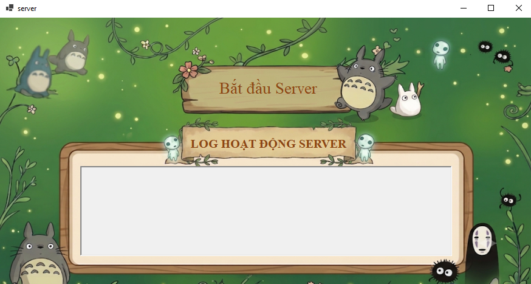
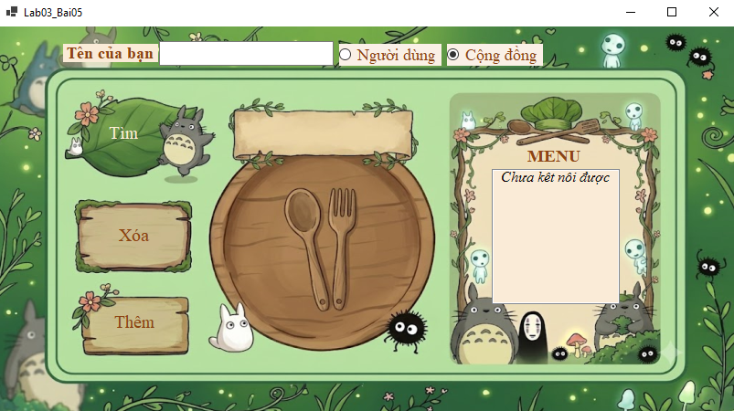
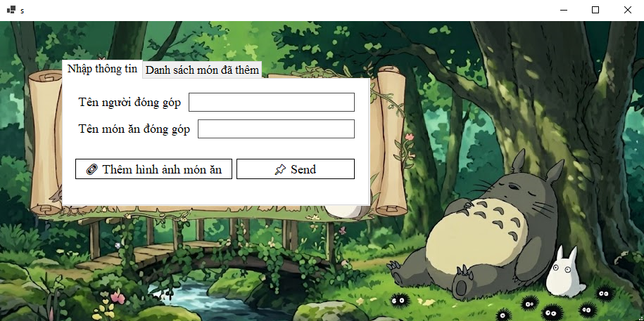
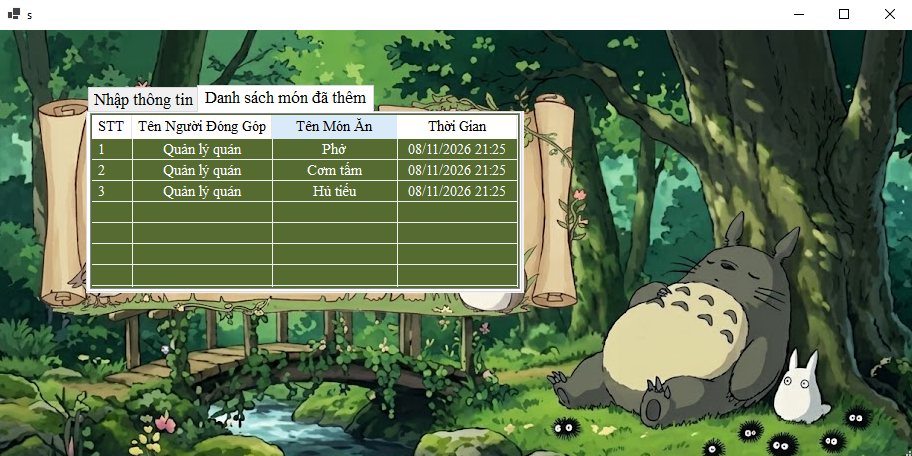

<h1 align="center">🌐 LAB 3 – WORKING WITH SOCKETS IN C#</h1>

<div align="center">

### LẬP TRÌNH SOCKETS TRONG C#

*Bài thực hành nhóm môn Lập trình mạng căn bản – Xây dựng ứng dụng giao tiếp Client–Server sử dụng UDP, TCP và Multithreading.*

<a href ="https://learn.microsoft.com/vi-vn/dotnet/csharp/" target="_blank" rel="noopener noreferrer">
    
  </a>
   <a href ="https://dotnet.microsoft.com/" target="_blank" rel="noopener noreferrer">
     
  </a>
  <a href ="https://learn.microsoft.com/vi-vn/dotnet/desktop/winforms/" target="_blank" rel="noopener noreferrer">
     
  </a>
  <a href="https://www.sqlite.org/">
     
  </a>
  <a href="https://vi.wikipedia.org/wiki/TCP">
     
  </a>
   <a href="https://vi.wikipedia.org/wiki/UDP">
     
  </a>
  <a href ="https://git-scm.com/" target="_blank" rel="noopener noreferrer">
     
  </a>
  <a href ="https://github.com/hongmynhu18years-svg/LAB03_NT106" target="_blank" rel="noopener noreferrer">
     
  </a>
  
</div>

---

## 👥 Thông tin nhóm thực hiện

| Nội dung | Thông tin |
|---|---|
| **Môn học** | Lập trình mạng căn bản |
| **Bài thực hành** | Lab 3 – Working with Sockets in C# |
| **Nhóm** | 3 |
| **Lớp** | NT106.R14.2 |

## 🧑‍💻 Danh sách thành viên

| STT | Họ và tên | MSSV | 
|:---:|---|:---:|
| 1 | Hồng Mỹ Như | 25521342 | 
| 2 | Tô Thị Thanh Nhi | 25521332 | 
| 3 | Trương Vũ Hoàng Ngân | 25521185 | 
| 4 | Võ Thị Minh Thư | 25521816 |
| 5 | Lê Hoàn Phúc | 25521422 |

---

## 📖 Giới thiệu

**LAB 3 – Working with Sockets in C#** là bài thực hành nhóm thuộc môn **Lập trình mạng căn bản**, tập trung xây dựng các ứng dụng giao tiếp qua mạng bằng ngôn ngữ **C#** trên nền tảng **Windows Forms**.

Bài thực hành giúp sinh viên làm quen với lập trình **Socket**, triển khai mô hình **Client–Server**, sử dụng hai giao thức **UDP** và **TCP** để truyền nhận dữ liệu. Đồng thời, nhóm vận dụng **Multithreading** để xử lý kết nối và giao tiếp giữa nhiều Client, kết hợp quản lý và đồng bộ dữ liệu trong các ứng dụng thực tế.

Tập hợp các bài thực hành Lab 3 trên một giao diện Windows Forms. Người dùng chọn bài tập từ form chính để thực hiện các chức năng từng bài tương ứng.


### 🎯 Mục tiêu thực hành

- Hiểu nguyên lý hoạt động của Socket và mô hình Client–Server.
- Xây dựng ứng dụng gửi và nhận thông điệp bằng UDP và TCP.
- Sử dụng các lớp `Socket`, `UdpClient`, `TcpClient` và `TcpListener`.
- Áp dụng Multithreading để xử lý các kết nối mạng.
- Phát triển ứng dụng hỗ trợ nhiều Client và đồng bộ dữ liệu thông qua Server.
- Kết hợp SQLite để lưu trữ và quản lý dữ liệu tập trung.

### 📚 Nội dung thực hành

| Bài | Tên bài thực hành | Mô hình / Công nghệ |
|:---:|---|---|
| **01** | Gửi và nhận dữ liệu bằng UDP | UDP Client – UDP Server |
| **02** | Lắng nghe dữ liệu từ Telnet | TCP Socket |
| **03** | Gửi và nhận dữ liệu bằng TCP | 1 Server – 1 Client |
| **04** | Quản lý phòng vé | 1 Server – Multi Client |
| **05** | Hôm nay ăn gì? | 1 Server – Multi Client, SQLite |
| **06** | Chat Room – Nhắn tin chung và riêng | TCP Client – TCP Listener |

---

## 📡 Bài 1 — Gửi và nhận dữ liệu bằng UDP

### 🖼️ Giao diện chương trình

**1. Form điều hướng — Gửi và nhận dữ liệu**


**2. Giao diện UDP Client**


**3. Giao diện UDP Server**


### 🎯 Nội dung thực hành

- Xây dựng ứng dụng gửi và nhận dữ liệu giữa hai bên thông qua giao thức **UDP (User Datagram Protocol)**.
- Cho phép người dùng tại **UDP Client** nhập địa chỉ IP, Port và thông điệp cần gửi.
- **UDP Server** lắng nghe tại Port được chỉ định, tiếp nhận thông điệp từ Client và hiển thị trên giao diện.
- Hỗ trợ gửi và nhận nội dung tiếng Việt có dấu thông qua mã hóa **UTF-8**.
- Kiểm tra dữ liệu đầu vào, xử lý lỗi kết nối và quản lý tài nguyên khi đóng chương trình.

### 🛠️ Cách thức thực hiện

**1. Form điều hướng (`Lab03_Bai01`)**

- Khởi tạo giao diện bằng `InitializeComponent()`.
- Sử dụng `btnServer_Click()` để mở form `Lab03_Bai01_UDPServer`.
- Sử dụng `btnUDPCLient_Click()` để mở form `Lab03_Bai01_UDPClient`.
- Sử dụng `btnThoat_Click()` để đóng form điều hướng.

**2. UDP Client (`Lab03_Bai01_UDPClient`)**

- Khởi tạo địa chỉ IP mặc định `127.0.0.1` và Port `9000` để kiểm thử trên cùng một máy.
- Đọc địa chỉ IP từ `tbxRemoteIP`, Port từ `tbxRemotePort` và thông điệp từ `rtbMessage`.
- Sử dụng `IPAddress.TryParse()` để kiểm tra địa chỉ IP hợp lệ.
- Sử dụng `int.TryParse()` để kiểm tra Port trong khoảng `1–65535`.
- Kiểm tra thông điệp không được để trống bằng `string.IsNullOrWhiteSpace()`.
- Sử dụng `Encoding.UTF8.GetBytes()` để chuyển thông điệp thành mảng byte.
- Khởi tạo `UdpClient` và sử dụng `Send()` để gửi dữ liệu đến IP và Port của Server.
- Sử dụng `using` để tự động giải phóng `UdpClient` sau khi gửi.
- Xử lý lỗi gửi dữ liệu bằng `try-catch` với `SocketException`.
- Hiển thị thông báo sau khi thực hiện gửi và sử dụng `Close()` để thoát form.

**3. UDP Server (`Lab03_Bai01_UDPServer`)**

- Đọc và kiểm tra Port từ `tbxServerPort`, đảm bảo giá trị trong khoảng `1–65535`.
- Sử dụng `new UdpClient(port)` để khởi tạo Server lắng nghe tại Port được chỉ định.
- Sử dụng `CancellationTokenSource` để quản lý việc hủy tác vụ nhận dữ liệu.
- Sử dụng `ReceiveMessagesAsync()` và `ReceiveAsync()` để nhận dữ liệu UDP bất đồng bộ.
- Sử dụng `Encoding.UTF8.GetString()` để chuyển dữ liệu nhận được từ mảng byte thành chuỗi.
- Lấy địa chỉ IP và Port của Client thông qua `result.RemoteEndPoint`.
- Hiển thị thời gian nhận, địa chỉ IP, Port và nội dung thông điệp trên `lstReceivedMessages`.
- Sử dụng `InvokeRequired` kết hợp `BeginInvoke()` trong `AppendMessage()` để cập nhật giao diện an toàn giữa các luồng.
- Tự động cuộn đến thông điệp mới nhất bằng `EnsureVisible()`.
- Vô hiệu hóa nút Listen và ô nhập Port trong lúc Server đang lắng nghe.
- Sử dụng `Cancel()` và `Dispose()` để hủy tác vụ nhận, đóng Socket và giải phóng tài nguyên khi thoát.

### ▶️ Hướng dẫn sử dụng

**1. Khởi động UDP Server**

1. Mở **Bài 1** từ giao diện chính của Lab 3.
2. Nhấn **UDP Server** để mở cửa sổ Server.
3. Nhập Port cần lắng nghe, ví dụ `9000`.
4. Nhấn **Listen** để bắt đầu nhận dữ liệu.
5. Kiểm tra thông báo `Server đang lắng nghe tại Port 9000...`.
6. Giữ cửa sổ Server hoạt động để tiếp nhận thông điệp.

**2. Gửi thông điệp từ UDP Client**

1. Tại form điều hướng, nhấn **UDP Client**.
2. Nhập địa chỉ IP của Server vào ô **IP Remote host**.
   - Cùng máy: `127.0.0.1`.
   - Khác máy trong mạng LAN: nhập địa chỉ IPv4 của máy chạy Server.
3. Nhập Port `9000` vào ô **Port**.
4. Nhập nội dung cần gửi vào ô **Message**, ví dụ `Xin chào UDP Server!`.
5. Nhấn **Send** để gửi thông điệp.
6. Client hiển thị thông báo `Đã gửi thông điệp qua UDP!` nếu thao tác gửi không phát sinh lỗi.
7. Kiểm tra cửa sổ Server để xem thông điệp được tiếp nhận.

**3. Kiểm tra kết quả tại Server**

Khi nhận được thông điệp, Server hiển thị dữ liệu theo cấu trúc:

```text
[14:30:25] 127.0.0.1:54321
Xin chào UDP Server!
```

Trong đó:

- `14:30:25`: Thời gian Server nhận thông điệp.
- `127.0.0.1`: Địa chỉ IP của Client.
- `54321`: Port nguồn của Client (ví dụ minh họa).
- `Xin chào UDP Server!`: Nội dung thông điệp nhận được.

**4. Thoát chương trình**

1. Nhấn **Thoát** tại UDP Client để đóng cửa sổ Client.
2. Nhấn **Thoát** tại UDP Server để dừng lắng nghe và đóng Socket.
3. Nhấn **Thoát** tại form điều hướng để kết thúc Bài 1.

> [!NOTE]
> - IP `127.0.0.1` chỉ dùng để giao tiếp trên cùng một máy. Khi chạy trên hai máy khác nhau trong LAN, phải sử dụng địa chỉ IP thực tế của Server.
> - Port tại Client phải trùng với Port mà Server đang lắng nghe.
> - Port hợp lệ nằm trong khoảng `1–65535`. Port mặc định được thiết lập tại Client là `9000`.
> - Thông điệp không được để trống hoặc chỉ chứa khoảng trắng.
> - Chương trình hỗ trợ Tiếng Việt có dấu nhờ mã hóa UTF-8.
> - UDP không đảm bảo thông điệp luôn được chuyển đến Server. Thông báo gửi thành công tại Client không đồng nghĩa Server đã nhận dữ liệu.
> - UDP Client sử dụng Port nguồn do hệ điều hành cấp phát, vì vậy Port nguồn hiển thị tại Server có thể thay đổi giữa các lần gửi.
> - Khi Port đã được ứng dụng khác sử dụng, Server có thể không khởi động được và sẽ hiển thị thông báo lỗi.
> - Khi kiểm thử trên các máy khác nhau, cần đảm bảo kết nối mạng và cấu hình tường lửa cho phép lưu lượng UDP tại Port tương ứng.
> - Khi đóng Server, chương trình hủy tác vụ nhận dữ liệu và giải phóng Socket để tránh chiếm dụng tài nguyên.

---


## 🖥️ Bài 2 — Lắng nghe dữ liệu từ Telnet bằng TCP

### 🖼️ Giao diện chương trình

**Giao diện TCP Server — FormTelnet**


### 🎯 Nội dung thực hành

- Xây dựng chương trình **TCP Server** có khả năng lắng nghe và tiếp nhận dữ liệu được gửi từ Telnet.
- Sử dụng giao thức **TCP (Transmission Control Protocol)** để thiết lập kết nối giữa Telnet Client và Server.
- Server lắng nghe tại địa chỉ IP `127.0.0.1` và Port `8080`.
- Cho phép người dùng gửi thông điệp từ Telnet thông qua Command Prompt (CMD).
- Nhận và hiển thị các thông điệp trên giao diện **Windows Forms**.
- Sử dụng **Thread** để chạy Server trên luồng riêng, tránh làm treo giao diện.
- Hiển thị thời gian nhận và tự động cuộn đến thông điệp mới nhất.

### 🛠️ Cách thức thực hiện

**1. Khởi tạo TCP Server**

- Sử dụng lớp `TcpListener` trong `System.Net.Sockets` để tạo Server.
- Thiết lập địa chỉ IP `127.0.0.1` và Port `8080` bằng `new TcpListener(IPAddress.Parse("127.0.0.1"), 8080)`.
- Sử dụng `listener.Start()` để bắt đầu lắng nghe kết nối TCP.
- Hiển thị thông báo `Telnet running on 127.0.0.1:8080` khi Server khởi động thành công.

**2. Xử lý sự kiện nút Listen**

- Bắt sự kiện `btnListen_Click()` khi người dùng nhấn nút **Listen**.
- Sử dụng biến `isListening` để kiểm tra trạng thái hoạt động của Server.
- Đổi nội dung nút thành `Listening...` và vô hiệu hóa nút để tránh khởi động Server nhiều lần.
- Khởi tạo luồng riêng bằng `new Thread(StartServer)`.
- Thiết lập `IsBackground = true` để luồng không ngăn tiến trình kết thúc.
- Gọi `Start()` để bắt đầu thực thi hàm `StartServer()`.

**3. Chấp nhận kết nối từ Telnet Client**

- Sử dụng `listener.AcceptTcpClient()` để chờ và chấp nhận kết nối TCP từ Client.
- Hiển thị thông báo `New client connected!` khi có Client kết nối.
- Sử dụng `client.GetStream()` để lấy `NetworkStream` phục vụ việc nhận dữ liệu.
- Khởi tạo `StreamReader` với mã hóa `Encoding.ASCII` để đọc dữ liệu từ luồng mạng.

**4. Nhận và xử lý thông điệp**

- Sử dụng `reader.ReadLine()` để đọc dữ liệu theo từng dòng.
- Khi người dùng nhập thông điệp và nhấn **Enter** trong Telnet, Server nhận nội dung dòng tương ứng.
- Sử dụng vòng lặp `while` để tiếp tục đọc cho đến khi Client ngắt kết nối.
- Gọi `AddMessage()` để hiển thị thông điệp trên `ListView`.
- Sử dụng `client.Close()` để đóng kết nối Client sau khi kết thúc nhận dữ liệu.

**5. Cập nhật giao diện an toàn giữa các luồng**

- Sử dụng `InvokeRequired` để kiểm tra việc cập nhật `ListView` từ luồng khác.
- Sử dụng `Invoke()` để chuyển thao tác cập nhật về luồng giao diện khi cần thiết.
- Sử dụng `DateTime.Now.ToString("HH:mm:ss")` để lấy thời gian hiển thị thông điệp.
- Thêm dữ liệu vào `lvMessages` bằng `ListViewItem`.
- Sử dụng `EnsureVisible()` để tự động cuộn đến thông điệp mới nhất.
- Kiểm tra `IsDisposed` trước khi cập nhật để hạn chế thao tác trên Control đã bị hủy.

**6. Xử lý lỗi**

- Sử dụng `try-catch` để bắt các ngoại lệ phát sinh trong quá trình khởi tạo, kết nối và nhận dữ liệu.
- Hiển thị thông báo lỗi trong `ListView` thông qua `AddMessage()` khi Server đang ở trạng thái lắng nghe.

### ▶️ Hướng dẫn sử dụng

**1. Khởi động TCP Server**

1. Mở **Bài 2** từ giao diện chính của Lab 3.
2. Nhấn nút **Listen** trên cửa sổ `FormTelnet`.
3. Server bắt đầu lắng nghe tại địa chỉ `127.0.0.1` và Port `8080`.
4. Nút Listen chuyển thành `Listening...` và bị vô hiệu hóa.
5. Kiểm tra thông báo khởi động trong khu vực **Messages**.

**2. Kết nối bằng Telnet**

1. Mở **Command Prompt (CMD)** trên Windows.
2. Nhập lệnh:

   ```cmd
   telnet 127.0.0.1 8080
   ```

3. Nhấn **Enter** để thực hiện kết nối.
4. Khi kết nối thành công, Server hiển thị thông báo `New client connected!`.

**3. Gửi và nhận thông điệp**

1. Tại cửa sổ Telnet, nhập một thông điệp, ví dụ:

   ```text
   Hello TCP Server!
   ```

2. Nhấn **Enter** để gửi thông điệp.
3. Server nhận dữ liệu và hiển thị thông điệp trong khu vực **Messages**.
4. Tiếp tục nhập các thông điệp khác để kiểm tra khả năng nhận dữ liệu liên tục.

**4. Kiểm tra kết quả trên Server**

Ví dụ nội dung hiển thị:

```text
[15:20:01] Telnet running on 127.0.0.1:8080
[15:20:10] New client connected!
[15:20:15] Hello TCP Server!
[15:20:20] Testing TCP connection
```

Trong đó:

- `[15:20:01]`: Thời gian ghi nhận sự kiện.
- `Telnet running...`: Server đã bắt đầu lắng nghe.
- `New client connected!`: Có Client kết nối thành công.
- `Hello TCP Server!`: Nội dung được gửi từ Telnet Client.

**5. Kết thúc chương trình**

1. Đóng cửa sổ Telnet để ngắt kết nối Client.
2. Server kết thúc vòng lặp đọc dữ liệu của Client hiện tại.
3. Đóng cửa sổ `FormTelnet` để kết thúc chương trình.

> [!NOTE]
> - Chương trình sử dụng giao thức **TCP**, yêu cầu thiết lập kết nối trước khi truyền dữ liệu.
> - Địa chỉ `127.0.0.1` là địa chỉ Loopback, chỉ cho phép kết nối từ cùng một máy.
> - Server sử dụng Port cố định `8080`; lệnh Telnet phải kết nối đúng Port này.
> - Cần nhấn **Listen** trước khi thực hiện kết nối Telnet.
> - Nếu Windows chưa bật Telnet Client, cần kích hoạt tính năng này trong **Windows Features** hoặc sử dụng lệnh `dism /online /Enable-Feature /FeatureName:TelnetClient`.
> - Chương trình sử dụng `Encoding.ASCII` để đọc thông điệp, vì vậy không hỗ trợ đầy đủ tiếng Việt có dấu.
> - `ReadLine()` đọc thông điệp theo từng dòng; dữ liệu chỉ được xử lý khi nhận được ký tự kết thúc dòng.
> - Server xử lý lần lượt từng Client, chưa hỗ trợ giao tiếp đồng thời với nhiều Client.
> - Khi Port `8080` đang được chương trình khác sử dụng, Server có thể không khởi động được.
> - `Thread` được thiết lập `IsBackground = true`, giúp luồng nền không giữ tiến trình tiếp tục chạy sau khi các luồng foreground đã kết thúc.

---


## 🔗 Bài 3 — Gửi và nhận dữ liệu bằng TCP (1 Server – 1 Client)

### 🖼️ Giao diện chương trình

**1. Form điều hướng — TCP Client/Server**


**2. Giao diện TCP Client**


**3. Giao diện TCP Server**


### 🎯 Nội dung thực hành

- Xây dựng ứng dụng gửi và nhận dữ liệu giữa **1 TCP Server và 1 TCP Client** bằng ngôn ngữ C# trên nền tảng Windows Forms.
- Sử dụng giao thức **TCP (Transmission Control Protocol)** để thiết lập kết nối và truyền dữ liệu qua mạng.
- Cho phép Server lắng nghe tại một Port được chỉ định và tiếp nhận thông điệp từ Client.
- Cho phép Client nhập địa chỉ IP, Port để kết nối và gửi thông điệp đến Server.
- Cung cấp các chức năng **Connect, Send, Disconnect** ở phía Client.
- Hiển thị trạng thái kết nối, nội dung thông điệp và sự kiện ngắt kết nối trên giao diện Server.
- Sử dụng **Thread** để xử lý kết nối trên luồng nền, tránh làm treo giao diện Windows Forms.

### 🛠️ Cách thức thực hiện

**1. Form điều hướng (`Lab03_Bai03`)**

- Khởi tạo giao diện bằng `InitializeComponent()`.
- Sử dụng `btnServer_Click()` để mở form `Lab03_Bai03_TCPServer`.
- Sử dụng `btnUDPCLient_Click()` để mở form `Lab03_Bai03_TCPClient`.
- Sử dụng `btnThoat_Click()` để đóng form điều hướng.

**2. TCP Server (`Lab03_Bai03_TCPServer`)**

- Đọc Port từ `txtPort` và chuyển thành số nguyên bằng `int.Parse()`.
- Sử dụng `TcpListener(IPAddress.Any, port)` để tạo Server lắng nghe tại Port đã chỉ định trên các địa chỉ IP cục bộ phù hợp.
- Gọi `listener.Start()` để bắt đầu lắng nghe kết nối.
- Sử dụng `Thread` với `IsBackground = true` để thực thi hàm `StartServer()` trên luồng nền.
- Gọi `listener.AcceptTcpClient()` để chờ và chấp nhận kết nối từ Client.
- Lấy thông tin địa chỉ Client thông qua `client.Client.RemoteEndPoint`.
- Sử dụng `client.GetStream()` để tạo `NetworkStream` nhận dữ liệu.
- Khởi tạo bộ đệm `byte[1024]` để đọc dữ liệu từ luồng mạng.
- Sử dụng `stream.Read()` để tiếp nhận dữ liệu liên tục cho đến khi Client đóng kết nối.
- Sử dụng `Encoding.ASCII.GetString()` để chuyển dữ liệu từ mảng byte thành chuỗi.
- Hiển thị thông điệp và trạng thái kết nối trên `lvServer`.
- Sử dụng `InvokeRequired` kết hợp `Invoke()` để cập nhật `ListView` từ luồng khác.
- Sử dụng `EnsureVisible()` để tự động cuộn đến thông điệp mới nhất.
- Vô hiệu hóa nút Listen và ô nhập Port trong khi Server đang hoạt động.
- Khi đóng form, sử dụng `listener.Stop()` để dừng lắng nghe kết nối.

**3. TCP Client (`Lab03_Bai03_TCPClient`)**

- Khai báo đối tượng `TcpClient` để quản lý kết nối và `NetworkStream` để truyền dữ liệu.
- Đọc địa chỉ IP từ `txtIP` và Port từ `txtPort`.
- Sử dụng `new TcpClient()` để khởi tạo Client.
- Gọi `tcpClient.Connect(ip, port)` để thiết lập kết nối đến Server.
- Sử dụng `tcpClient.GetStream()` để lấy luồng giao tiếp.
- Hiển thị thông báo khi kết nối thành công và vô hiệu hóa nút Connect.
- Đọc nội dung từ `txtMessage` và thêm ký tự xuống dòng `\n`.
- Sử dụng `Encoding.ASCII.GetBytes()` để chuyển thông điệp thành mảng byte.
- Gửi dữ liệu bằng `stream.Write(data, 0, data.Length)`.
- Xóa nội dung ô nhập và đưa con trỏ về `txtMessage` sau khi gửi.
- Kiểm tra trạng thái kết nối trước khi gửi dữ liệu; hiển thị cảnh báo nếu chưa kết nối.
- Khi nhấn Disconnect, gửi thông điệp `quit\n` nếu kết nối còn hoạt động.
- Đóng `NetworkStream`, đóng `TcpClient` và đặt đối tượng kết nối về `null`.
- Kích hoạt lại nút Connect để người dùng có thể kết nối lại.
- Sử dụng `try-catch` để xử lý lỗi kết nối, gửi dữ liệu và ngắt kết nối.

### ▶️ Hướng dẫn sử dụng

**1. Khởi động TCP Server**

1. Mở **Bài 3** từ giao diện chính của Lab 3.
2. Nhấn **TCP Server** tại form điều hướng.
3. Nhập Port cần lắng nghe, ví dụ `8080`.
4. Nhấn **Listen** để khởi động Server.
5. Nút Listen chuyển thành `Listening...` và bị vô hiệu hóa.
6. Kiểm tra thông báo `Server started! Waiting for connection...` trong khu vực Messages.

**2. Kết nối TCP Client**

1. Tại form điều hướng, nhấn **TCP Client**.
2. Nhập địa chỉ IP của Server vào ô IP, ví dụ `127.0.0.1` khi chạy trên cùng một máy.
3. Nhập Port `8080`, trùng với Port Server đang lắng nghe.
4. Nhấn **Connect** để thiết lập kết nối.
5. Kiểm tra thông báo `Kết nối đến Server thành công!`.
6. Quan sát thông báo `Connection accepted from ...` trên giao diện Server.

**3. Gửi thông điệp từ Client**

1. Nhập nội dung cần gửi vào ô nhập thông điệp của TCP Client, ví dụ:

   ```text
   Hello TCP Server!
   ```

2. Nhấn **Send** để gửi dữ liệu đến Server.
3. Chương trình chuyển thông điệp thành mảng byte và gửi qua `NetworkStream`.
4. Sau khi thao tác gửi hoàn tất, ô nhập thông điệp được xóa.
5. Kiểm tra nội dung nhận được trong khu vực **Messages** của TCP Server.
6. Tiếp tục nhập và gửi các thông điệp khác nếu cần.

**4. Ngắt kết nối TCP Client**

1. Nhấn **Disconnect** trên giao diện TCP Client.
2. Nếu kết nối còn hoạt động, Client gửi thông điệp `quit` đến Server.
3. Chương trình đóng luồng giao tiếp và kết nối TCP.
4. Client hiển thị thông báo `Đã ngắt kết nối khỏi Server.`.
5. Nút Connect được kích hoạt lại để cho phép kết nối mới.
6. Server ghi nhận thông điệp `quit` và trạng thái Client ngắt kết nối.

**5. Kiểm tra kết quả tại TCP Server**

Ví dụ nội dung hiển thị trong khu vực Messages:

```text
Server started! Waiting for connection...
Connection accepted from 127.0.0.1:54321
From client: Hello TCP Server!
From client: Testing TCP connection
From client: quit
Client disconnected.
```

Trong đó:

- `Server started!`: Server đã khởi động và bắt đầu lắng nghe.
- `Connection accepted from ...`: Server đã chấp nhận kết nối từ Client.
- `From client: ...`: Dữ liệu mà Server nhận được từ Client.
- `Client disconnected.`: Client đã đóng kết nối.

**6. Kết thúc chương trình**

1. Nhấn **Disconnect** tại TCP Client để ngắt kết nối.
2. Đóng cửa sổ TCP Client.
3. Đóng cửa sổ TCP Server để dừng lắng nghe.
4. Nhấn **Thoát** tại form điều hướng để kết thúc Bài 3.

> [!NOTE]
> - Cần khởi động Server và nhấn **Listen** trước khi Client nhấn **Connect**.
> - Port tại Client phải trùng với Port mà Server đang lắng nghe, ví dụ `8080`.
> - Khi chạy trên cùng một máy, có thể sử dụng địa chỉ Loopback `127.0.0.1`.
> - Khi chạy trên hai máy khác nhau trong cùng mạng LAN, Client cần nhập địa chỉ IPv4 của máy chạy Server.
> - `IPAddress.Any` cho phép Server lắng nghe trên các giao diện mạng IPv4 cục bộ.
> - Chương trình sử dụng `Encoding.ASCII`, vì vậy chưa hỗ trợ đầy đủ tiếng Việt có dấu.
> - Phải kết nối thành công trước khi gửi; nếu chưa kết nối, Client sẽ hiển thị cảnh báo.
> - Sau khi kết nối thành công, nút Connect bị vô hiệu hóa cho đến khi người dùng Disconnect.
> - Thông điệp `quit` được gửi trước khi đóng kết nối nhưng Server hiện chỉ hiển thị thông điệp này, không xử lý nó như một lệnh đặc biệt.
> - Server xử lý từng Client lần lượt, chưa hỗ trợ nhiều Client giao tiếp đồng thời.
> - TCP là giao thức truyền dữ liệu dạng luồng byte. Mỗi lần `Read()` không nhất thiết tương ứng với đúng một lần `Write()` từ Client.
> - Port phải là số nguyên hợp lệ trong khoảng `1–65535`; code hiện tại sử dụng `int.Parse()` và bắt ngoại lệ khi giá trị không hợp lệ.
> - Nếu Port đang bị ứng dụng khác chiếm dụng hoặc bị tường lửa chặn, kết nối có thể thất bại.
> - Khi đóng form Server, chương trình gọi `listener.Stop()` để dừng lắng nghe.
> - Các thao tác kết nối và gửi dữ liệu tại Client đang được thực hiện đồng bộ, vì vậy giao diện có thể tạm thời không phản hồi khi mạng bị chậm hoặc kết nối gặp sự cố.

---

## 🎬 Bài 4 — Quản lý phòng vé (1 Server – Multi Client)

### 🖼️ Giao diện chương trình

**1. Giao diện chọn phim — Select Movie**


**2. Giao diện đặt vé — Booking Form**


**3. Giao diện xác thực quản trị viên — Password Form**


**4. Giao diện quản lý và xuất thống kê — Admin Form**


### 🎯 Nội dung thực hành

- Xây dựng ứng dụng **quản lý phòng vé xem phim** theo mô hình **1 Server – Multi Client**, kế thừa chức năng đặt vé của Bài 5 – Lab 2.
- Sử dụng giao thức **TCP** để kết nối và trao đổi dữ liệu giữa Server với nhiều Client.
- Quản lý tập trung trạng thái ghế đã đặt tại Server, đảm bảo các Client có thể cập nhật và đồng bộ thông tin đặt vé.
- Ngăn chặn tình trạng nhiều Client đặt trùng một ghế trong cùng phim và phòng chiếu.
- Cho phép khách hàng chọn phim, phòng chiếu, ghế ngồi và thực hiện đặt vé.
- Tính tổng tiền dựa trên giá vé chuẩn và hệ số của từng loại ghế.
- Hiển thị hóa đơn sau khi Server xác nhận đặt vé thành công.
- Cung cấp giao diện quản trị viên để thống kê số vé bán, vé còn lại, tỷ lệ bán, doanh thu và xếp hạng.
- Lưu trạng thái ghế đã đặt vào file tại Server và xuất báo cáo thống kê ra file `.txt`.

### 🛠️ Cách thức thực hiện

**1. Khởi tạo TCP Server (`Lab03_Bai04_Server`)**

- Sử dụng `TcpListener` với `IPAddress.Any` và Port `8080` để khởi tạo Server.
- Gọi `StartServer()` trong `Program.Main()` để tự động khởi động Server khi chạy ứng dụng.
- Sử dụng `Thread` với `IsBackground = true` để chạy Server trên luồng nền.
- Dùng `AcceptTcpClient()` để chấp nhận kết nối từ các Client.
- Tạo một Thread riêng cho mỗi Client thông qua `HandleClient()` nhằm xử lý nhiều kết nối.
- Sử dụng `Dictionary<string, HashSet<string>>` để quản lý danh sách ghế đã đặt theo từng phim và phòng chiếu.
- Dùng `lock(lockObj)` để đồng bộ thao tác truy cập dữ liệu, kiểm tra và cập nhật ghế đã đặt.
- Sử dụng `StreamReader` và `StreamWriter` với mã hóa UTF-8 để trao đổi thông điệp qua TCP.
- Đọc dữ liệu từ `Lab03_Bai04_Seats.txt` bằng `LoadData()` và ghi trạng thái ghế bằng `SaveData()`.
- Sử dụng `BroadcastUpdate()` để thông báo trạng thái ghế mới cho các Client đang kết nối.

**2. Giao diện chọn phim (`Lab03_Bai04`)**

- Cho phép người dùng nhập tên khách hàng vào `txtCustomerName`.
- Kiểm tra tên khách hàng không được để trống trước khi chọn phim.
- Hiển thị bốn bộ phim thông qua các poster tương ứng.
- Xử lý lựa chọn phim bằng các sự kiện `btnDaoPhoPiano_Click()`, `btnMai_Click()`, `btnGapLaiChiBau_Click()` và `btnTarot_Click()`.
- Truyền tên phim, giá vé chuẩn và tên khách hàng đến `Lab03_Bai04_BookingForm`.
- Sử dụng `ShowDialog()` để mở giao diện đặt vé.
- Cho phép truy cập khu vực quản trị thông qua liên kết **Quản lý hệ thống**.
- Sử dụng `System.Windows.Forms.Timer` và `FrameDimension` để hiển thị hiệu ứng GIF trên giao diện.
- Hỗ trợ thu nhỏ, phóng to và đóng cửa sổ.

**3. Giao diện đặt vé (`Lab03_Bai04_BookingForm`)**

- Nhận thông tin phim, giá vé và tên khách hàng thông qua Constructor.
- Hiển thị tên phim và khách hàng ở chế độ `ReadOnly`.
- Tạo danh sách phòng chiếu phù hợp với từng bộ phim bằng `ComboBox`.
- Khởi tạo kết nối TCP đến Server tại `127.0.0.1:8080`.
- Sử dụng `ConnectToServerAndListen()` để kết nối và tạo Thread nhận thông điệp từ Server.
- Gửi yêu cầu `GET_SEATS` để lấy trạng thái ghế đã đặt.
- Sử dụng `ApplyBookedSeatsToUI()` để cập nhật trạng thái các nút ghế.
- Cho phép người dùng chọn hoặc bỏ chọn ghế chưa được đặt.
- Sử dụng `TinhTongTien()` để tính tổng tiền dựa trên hệ số giá của từng ghế.
- Gửi yêu cầu `BOOK` đến Server khi nhấn **Thanh Toán**.
- Nhận kết quả `SUCCESS` hoặc `FAILED` từ Server.
- Hiển thị hóa đơn bằng `HienThiHoaDonThanhCong()` sau khi đặt vé thành công.
- Sử dụng `LockSelectedSeats()` để khóa các ghế đã thanh toán.
- Cho phép hủy lựa chọn ghế chưa thanh toán bằng nút **Hủy**.
- Đóng kết nối TCP khi người dùng thoát khỏi form.

**4. Đồng bộ trạng thái ghế giữa các Client**

- Server sử dụng khóa dữ liệu gồm **tên phim và phòng chiếu** để phân biệt các danh sách ghế.
- Khi Client yêu cầu `GET_SEATS`, Server trả về danh sách ghế đã đặt thông qua thông điệp `SEATS`.
- Khi nhận yêu cầu `BOOK`, Server kiểm tra toàn bộ ghế được yêu cầu trong một vùng khóa `lock`.
- Nếu có ghế đã được đặt, Server từ chối giao dịch và trả về `FAILED`.
- Nếu tất cả ghế còn trống, Server cập nhật danh sách ghế và trả về `SUCCESS`.
- Sau khi đặt vé thành công, Server gọi `BroadcastUpdate()` để gửi `SEAT_UPDATED` đến các Client.
- Các Client cập nhật màu sắc và vô hiệu hóa những ghế đã được đặt.
- Nếu ghế người dùng đang chọn vừa được Client khác đặt trước, chương trình hiển thị cảnh báo và cập nhật lại trạng thái ghế.

**5. Tính giá vé và thanh toán**

Giá vé được xác định theo công thức:

`Giá ghế = Giá vé chuẩn × Hệ số loại ghế`

| Loại ghế | Vị trí | Hệ số giá |
|---|---|---|
| Vé vớt | A1, A5, C1, C5 | 0.25 |
| Vé thường | A2, A3, A4, B1, B5, C2, C3, C4 | 1.0 |
| Vé VIP | B2, B3, B4 | 2.0 |

**Giá vé chuẩn của các bộ phim:**

| Tên phim | Giá vé chuẩn |
|---|---:|
| Đào, phở và piano | 45.000 VNĐ |
| Mai | 100.000 VNĐ |
| Gặp lại chị bầu | 70.000 VNĐ |
| Tarot | 90.000 VNĐ |

- Sử dụng `decimal` để tính toán giá vé và tổng tiền.
- Cập nhật tổng tiền khi người dùng chọn hoặc bỏ chọn ghế.
- Kiểm tra người dùng đã chọn ít nhất một ghế trước khi thanh toán.
- Gửi danh sách ghế cần đặt đến Server để kiểm tra và xác nhận.
- Chỉ hiển thị hóa đơn thành công sau khi nhận phản hồi `SUCCESS`.
- Sau khi thanh toán, các ghế đã mua chuyển sang màu đỏ và không thể chọn lại.

**6. Xác thực quản trị viên (`Lab03_Bai04_PasswordForm`)**

- Cho phép người dùng truy cập khu vực quản trị thông qua liên kết **Quản lý hệ thống**.
- Yêu cầu nhập mật khẩu trước khi truy cập giao diện quản lý.
- Kiểm tra mật khẩu không được để trống.
- So sánh mật khẩu nhập vào với giá trị được cấu hình trực tiếp trong code.
- Nếu mật khẩu không chính xác, chương trình hiển thị thông báo lỗi.
- Nếu xác thực thành công, mở `Lab03_Bai04_AdminForm`.
- Sử dụng `Timer` để hiển thị hiệu ứng GIF trên giao diện.

**7. Quản lý và xuất thống kê (`Lab03_Bai04_AdminForm`)**

- Sử dụng `TcpClient` để kết nối đến Server tại `127.0.0.1:8080`.
- Gửi lệnh `GET_ALL` để yêu cầu toàn bộ dữ liệu ghế đã đặt.
- Nhận dữ liệu qua thông điệp `ALL_DATA` và phân tích theo phim, phòng chiếu.
- Sử dụng `DocBangGia()` để đọc giá vé chuẩn từ file `input5.txt` nếu file tồn tại và có định dạng phù hợp.
- Sử dụng giá mặc định `100000` khi không tìm thấy giá của phim trong file.
- Xác định số vé đã bán dựa trên số ghế được lưu tại Server.
- Tính số vé còn lại, tỷ lệ bán và doanh thu dựa trên loại ghế.
- Sắp xếp thống kê theo doanh thu giảm dần bằng `OrderByDescending()`.
- Hiển thị kết quả trong `lvThongKe` với các cột thông tin tương ứng.
- Sử dụng `Task.Run()` để lấy dữ liệu từ Server mà không chặn luồng giao diện.
- Sử dụng `ProgressBar` để biểu thị các mốc tiến trình trong quá trình lập báo cáo.
- Sử dụng `SaveFileDialog` để cho phép chọn vị trí lưu file.
- Ghi báo cáo ra file `output5.txt` bằng `StreamWriter` với mã hóa UTF-8.

### 📊 Nội dung thống kê

| Thông tin | Cách xác định |
|---|---|
| Tổng số vé | 15 ghế cho mỗi phim tại mỗi phòng chiếu được thống kê |
| Số vé đã bán | Số ghế được ghi nhận đã đặt tại Server |
| Số vé còn lại | Tổng số vé − Số vé đã bán |
| Tỷ lệ bán | Số vé đã bán / Tổng số vé × 100% |
| Doanh thu | Tổng giá của các ghế đã đặt theo hệ số giá |
| Xếp hạng | Doanh thu giảm dần |

### ▶️ Hướng dẫn sử dụng

**1. Khởi động Server**

1. Mở chương trình **Lab 3**.
2. Khi ứng dụng chạy, `Program.Main()` gọi `Lab03_Bai04_Server.StartServer()` để khởi động Server.
3. Server lắng nghe kết nối tại Port `8080`.
4. Mở **Bài 4 – Quản lý phòng vé** từ giao diện điều hướng.
5. Đảm bảo Server đã hoạt động trước khi thực hiện đặt vé.

**2. Chọn phim**

1. Tại giao diện **Select Movie**, nhập tên khách hàng.
2. Chọn một trong bốn bộ phim bằng cách nhấn vào poster tương ứng.
3. Nếu chưa nhập tên khách hàng, chương trình hiển thị thông báo yêu cầu bổ sung.
4. Sau khi chọn phim hợp lệ, giao diện đặt vé được mở với thông tin khách hàng và phim đã chọn.

**3. Chọn phòng chiếu và ghế ngồi**

1. Tại giao diện đặt vé, chọn phòng chiếu trong danh sách **Chọn phòng chiếu**.
2. Quan sát sơ đồ gồm 15 ghế, chia thành ba hàng A, B và C.
3. Nhấn vào ghế còn trống để chọn.
4. Ghế được chọn chuyển sang màu xanh lá.
5. Nhấn lại ghế đang chọn để bỏ chọn.
6. Kiểm tra tổng tiền được cập nhật trên giao diện.
7. Những ghế đã được đặt sẽ hiển thị màu đỏ và bị vô hiệu hóa.

**4. Thanh toán và nhận hóa đơn**

1. Chọn ít nhất một ghế chưa được đặt.
2. Nhấn **Thanh Toán**.
3. Client gửi yêu cầu đặt vé đến Server.
4. Server kiểm tra trạng thái các ghế được chọn.
5. Nếu đặt vé thành công, Client nhận phản hồi `SUCCESS`.
6. Hóa đơn hiển thị thông tin khách hàng, phim, phòng chiếu, danh sách ghế và tổng tiền.
7. Ghế đã thanh toán được khóa để tránh lựa chọn lại.
8. Nếu ghế đã được Client khác đặt, chương trình hiển thị cảnh báo và yêu cầu lựa chọn lại.

**5. Kiểm tra đồng bộ giữa nhiều Client**

1. Mở chương trình trên hai máy hoặc hai phiên ứng dụng.
2. Đảm bảo các Client có thể kết nối đến cùng một Server.
3. Tại Client 1, chọn một bộ phim, phòng chiếu và ghế còn trống.
4. Nhấn **Thanh Toán** để hoàn tất việc đặt vé.
5. Server cập nhật trạng thái ghế và gửi thông báo đến các Client.
6. Tại Client 2, quan sát ghế vừa được đặt chuyển sang trạng thái không thể chọn.
7. Thử đặt ghế đã được Client khác mua để kiểm tra cơ chế từ chối đặt trùng.

**6. Truy cập khu vực quản trị**

1. Trở về giao diện **Select Movie**.
2. Nhấn **Quản lý hệ thống**.
3. Nhập mật khẩu quản trị.
4. Nhấn **Xác nhận**.
5. Nếu mật khẩu hợp lệ, chương trình mở giao diện quản trị.
6. Nếu mật khẩu không đúng hoặc để trống, chương trình hiển thị thông báo lỗi.

**7. Xem và xuất thống kê**

1. Tại giao diện quản trị, nhấn **Xuất thống kê**.
2. Chương trình gửi yêu cầu lấy toàn bộ dữ liệu ghế đã đặt đến Server.
3. Dữ liệu được xử lý để tính số vé bán, vé tồn, tỷ lệ bán và doanh thu.
4. Kết quả hiển thị trong bảng thống kê, sắp xếp theo doanh thu giảm dần.
5. Theo dõi thanh tiến trình trong quá trình tạo báo cáo.
6. Nhấn **Ghi File** để lưu kết quả.
7. Chọn vị trí lưu và xác nhận tên file `output5.txt`.
8. Mở file đã lưu để kiểm tra nội dung thống kê.

### 📁 Cấu trúc dữ liệu lưu trữ

**1. File `Lab03_Bai04_Seats.txt`**

Server sử dụng file này để lưu danh sách ghế đã được đặt.

Cấu trúc mỗi dòng:

`Tên phim_Phòng chiếu|Danh sách ghế đã đặt`

Ví dụ:

```text
Mai_Phòng chiếu 2|A1,B2,C3
Tarot_Phòng chiếu 3|B1,B3
```

- Mỗi dòng đại diện cho trạng thái ghế của một phim tại một phòng chiếu.
- Các ghế đã đặt được phân cách bằng dấu phẩy.
- File được đọc khi Server khởi động và được cập nhật sau khi đặt vé thành công.

**2. File `input5.txt`**

- Được `AdminForm` sử dụng để đọc bảng giá vé khi lập thống kê.
- Theo code hiện tại, chương trình đọc giá ở dòng thứ hai của từng nhóm năm dòng.
- Nếu không tìm thấy giá tương ứng, chương trình sử dụng giá mặc định `100000`.

**3. File `output5.txt`**

- Chứa báo cáo thống kê doanh thu phòng vé.
- Bao gồm thông tin phim, phòng chiếu, giá chuẩn, tổng vé, vé bán, vé còn lại, tỷ lệ bán, doanh thu và xếp hạng.
- File được ghi bằng UTF-8 và lưu tại vị trí người dùng lựa chọn.

> [!NOTE]
> - **Server sử dụng Port `8080`** và tự động khởi động khi chạy ứng dụng qua `Program.Main()`.
> - Chương trình sử dụng mô hình **1 Server – nhiều Client**, mỗi Client được xử lý bằng một Thread riêng.
> - Mỗi phòng chiếu có **15 ghế**, được chia thành ba hàng A, B và C.
> - Trạng thái ghế được quản lý theo từng cặp **phim – phòng chiếu**, không dùng chung giữa các phòng.
> - Client cần kết nối được đến Server trước khi đặt vé.
> - Code `BookingForm` và `AdminForm` hiện kết nối đến địa chỉ cố định `127.0.0.1`. Muốn chạy trên nhiều máy khác nhau trong mạng LAN, cần thay bằng địa chỉ IP của máy Server.
> - Khi một ghế đã được thanh toán thành công, các Client khác sẽ nhận thông báo cập nhật trạng thái ghế.
> - Server sử dụng `lock` để tránh hai Client đặt thành công cùng một ghế trong các yêu cầu đồng thời.
> - Ghế chưa thanh toán có thể bỏ chọn bằng nút **Hủy**. Ghế đã thanh toán không thể hủy qua chức năng này.
> - Trạng thái ghế được lưu vào `Lab03_Bai04_Seats.txt` trong thư mục thực thi và được đọc lại khi khởi động Server.
> - Dữ liệu lưu trữ hiện chỉ bao gồm trạng thái ghế đã đặt, không phải toàn bộ thông tin giao dịch hoặc khách hàng.
> - Giá vé tại giao diện chọn phim được khai báo trực tiếp trong code; giá dùng để lập thống kê được đọc từ `input5.txt` hoặc dùng giá mặc định. Cần đảm bảo hai nguồn giá thống nhất để kết quả doanh thu chính xác.
> - Thống kê chỉ bao gồm các cặp phim – phòng chiếu có trong dữ liệu Server trả về. Các phòng chưa phát sinh dữ liệu ghế có thể không xuất hiện trong báo cáo.
> - Chức năng quản trị sử dụng mật khẩu cố định trong mã nguồn, phù hợp cho mục đích thực hành nhưng chưa phải phương án xác thực an toàn cho hệ thống thực tế.
> - `ProgressBar` biểu thị các mốc xử lý được thiết lập trong code, chưa phản ánh chính xác phần trăm công việc hoàn thành theo thời gian thực.
> - File `output5.txt` được lưu theo đường dẫn mà người dùng chọn trong `SaveFileDialog`, không nhất thiết nằm trong thư mục chạy chương trình.
> - Nếu Port `8080` bị ứng dụng khác sử dụng, Server có thể không khởi động được.

---
# 🍽️ Bài 5 — Hôm nay ăn gì? (1 Server – Multi Client)

## 🖼️ Giao diện chương trình

**1. Giao diện Server (`Server`)**


**2. Giao diện Client Chính — Random Menu (`Lab03_Bai05`)**


**3. Giao diện Đóng góp món ăn — Tab Nhập thông tin (`Donggopmonan`)**


**4. Giao diện Đóng góp món ăn — Tab Danh sách (`Donggopmonan`)**


---

## 🎯 Nội dung thực hành

- Xây dựng ứng dụng quản lý và đề xuất món ăn theo mô hình **1 Server – Multi Client**.
- Sử dụng giao thức **TCP** thông qua `TcpListener` và `TcpClient` để truyền tải gói tin.
- Quản lý tập trung dữ liệu tại Server bằng cơ sở dữ liệu **SQLite** (`data.db`).
- Áp dụng kỹ thuật **Tuần tự hóa JSON** (`System.Text.Json`) để đóng gói dữ liệu và mã hóa hình ảnh thành chuỗi **Base64** để truyền qua mạng.
- Áp dụng triệt để lập trình bất đồng bộ (`async`/`await`, `Task.Run`) trong tất cả các khâu đọc/ghi CSDL và NetworkStream để chống hiện tượng đơ giao diện (UI Freezing).
- Cho phép khách hàng thêm món mới kèm hình ảnh, xem danh sách chi tiết đóng góp, xóa món ăn, và quay ngẫu nhiên (Random) theo sở thích cá nhân hoặc cộng đồng.

---

## 🛠️ Cách thức thực hiện

### 1. Khởi tạo TCP Server và CSDL (`Server.cs`)
- Khởi chạy Server ở cổng `8888` bằng `TcpListener(IPAddress.Any, 8888)`.
- Dùng `Task.Run` để khởi tạo CSDL SQLite ngầm: tạo bảng `NguoiDung`, `MonAn` và chèn 3 món mặc định (Phở, Cơm tấm, Hủ tiếu).
- Lắng nghe kết nối liên tục bằng vòng lặp `while(isRunning)` và cấp phát một `Task` riêng (`HandleClient`) cho mỗi Client mới.
- Khai báo bộ đệm lớn `byte[1024 * 5000]` (5MB) để đảm bảo đủ dung lượng nhận chuỗi Base64 của hình ảnh.

### 2. Giao diện Client Chính (`Lab03_Bai05.cs`)
- Gửi yêu cầu `GET_LIST` ngay khi Form Load để lấy danh sách tên món và nạp vào khung `MENU` (`list_mon`).
- Xử lý chức năng **Tìm (Random)**:
  - Kiểm tra điều kiện đầu vào (Bắt buộc nhập tên nếu chọn chế độ "Người dùng").
  - Đóng gói lệnh `RANDOM_ALL` hoặc `RANDOM_MINE` gửi tới Server.
  - Nhận chuỗi JSON phản hồi, giải mã `HinhAnhBase64` thành mảng byte, đưa vào `MemoryStream` và gán cho `PictureBox` (`anh_mon.Image`).
- Xử lý chức năng **Xóa**: Gửi lệnh `DELETE` kèm tên món, cập nhật lại Menu nếu Server trả về `DELETE_SUCCESS`.
- Các nút bấm được khóa (`btn.Enabled = false`) trong lúc chờ tác vụ mạng chạy ngầm và mở lại ở khối `finally`.

### 3. Giao diện Đóng góp món ăn (`Donggopmonan.cs`)
- Form sử dụng `TabControl` với 2 chức năng chính: Thêm mới và Xem danh sách.
- **Tab Nhập thông tin:** Dùng `OpenFileDialog` để chọn ảnh, đọc ảnh bằng `File.ReadAllBytes()` và chuyển sang chuỗi bằng `Convert.ToBase64String()`. Gửi gói tin `ADD` chứa tên người, tên món và ảnh.
- **Tab Danh sách món đã thêm:** Gửi yêu cầu `GET_ALL_DETAILS` đến Server. Server dùng lệnh `JOIN` trong SQL để lấy đầy đủ chi tiết và trả về danh sách JSON. Client duyệt mảng JSON và đổ dữ liệu vào `ListView` gồm các cột: STT, Tên người, Tên món, Thời gian.

---

## 📊 Cấu trúc Giao thức (Packet Actions)

Mọi thao tác giao tiếp đều thông qua lớp `Packet` được chuyển đổi thành định dạng JSON.

| Action (Client gửi) | Tham số đi kèm | Xử lý tại Server | Phản hồi (Server gửi) |
| :--- | :--- | :--- | :--- |
| `ADD` | `TenMonAn`, `NguoiDongGop`, `HinhAnhBase64` | `INSERT` dữ liệu vào CSDL, lưu ảnh ra file `.png` ở thư mục `bin/Debug`. Báo lỗi nếu trùng món. | `SUCCESS` hoặc `ERROR` |
| `DELETE` | `TenMonAn` | `DELETE` món ăn khỏi bảng `MonAn`. | `DELETE_SUCCESS` / `FAIL` |
| `RANDOM_ALL` | *Không có* | Quay ngẫu nhiên 1 món từ toàn bộ CSDL (`ORDER BY RANDOM() LIMIT 1`). Lấy ảnh mã hóa lại thành Base64. | `RESULT` kèm Ảnh / `EMPTY` |
| `RANDOM_MINE`| `NguoiDongGop` | Lọc món theo tên người dùng và quay ngẫu nhiên. | `RESULT` kèm Ảnh / `EMPTY` |
| `GET_LIST` | *Không có* | `SELECT DISTINCT TenMonAn` | `LIST_RESULT` kèm JSON mảng |
| `GET_ALL_DETAILS`| *Không có* | `SELECT ... JOIN` bảng người dùng và bảng món ăn | `DETAILS_RESULT` kèm JSON chi tiết |

---

## 📖 Hướng dẫn sử dụng

**1. Khởi động Server**
1. Mở ứng dụng, chọn Form Server. Nhấn nút **Bắt đầu Server**.
2. Đợi Log thông báo "Server đã reset CSDL và đang chạy ở Port 8888...".

**2. Random món ăn (Client)**
1. Mở giao diện Client.
2. Nhập tên của bạn vào ô **Tên của bạn**.
3. Chọn chế độ: **Người dùng** (Chỉ quay ra món của bạn) hoặc **Cộng đồng** (Quay ngẫu nhiên từ kho chung).
4. Nhấn nút **Tìm**. Kết quả (tên, tác giả, hình ảnh) sẽ hiện ra ở giữa mâm gỗ.

**3. Đóng góp món mới**
1. Từ Client, nhấn nút **Thêm** để mở form Đóng góp món ăn.
2. Nhập tên người đóng góp, tên món ăn.
3. Nhấn **Thêm hình ảnh món ăn** và chọn 1 bức ảnh từ máy tính.
4. Nhấn **Send**. Hệ thống sẽ thông báo thành công và cập nhật món mới vào cơ sở dữ liệu.

**4. Xem danh sách chi tiết**
1. Tại form Đóng góp món ăn, chuyển sang tab **Danh sách món đã thêm**.
2. Một bảng chi tiết sẽ hiện ra với lịch sử thời gian cụ thể của các món đã được thêm vào hệ thống.

**5. Xóa món ăn**
1. Tại giao diện Client chính, nhấp chọn một tên món ăn trong khung MENU.
2. Nhấn nút **Xóa**.
3. Xác nhận "Yes" để xóa món khỏi hệ thống. Khung MENU sẽ tự động cập nhật lại.

---

## 📁 Cấu trúc dữ liệu lưu trữ

- **Cơ sở dữ liệu:** Hệ thống dùng SQLite với file `data.db` làm trung tâm lưu trữ, bao gồm 2 bảng `NguoiDung` và `MonAn` có quan hệ với nhau qua khóa ngoại `IDNCC`.
- **Thư mục ảnh mặc định (`Resources`):** Chứa các ảnh thiết lập sẵn (Phở, Cơm tấm, Hủ tiếu).
- **Thư mục ảnh Upload (`bin/Debug`):** Chứa các ảnh do Client tải lên, tự động sinh tên file theo định dạng `img_[Ticks].png` để tránh ghi đè.

## 📝 Note
- Client luôn kết nối trực tiếp đến IP `127.0.0.1:8888`. Để triển khai mô hình nhiều máy tính, cần chỉnh sửa IP này thành IP LAN của máy cài đặt Server.
- Để tối ưu hóa và chống treo UI (UI Freezing), tất cả lệnh `Stream.Read`, `Stream.Write` và các lệnh truy vấn SQLite đều được đặt bên trong `await Task.Run(...)`.
- Thuộc tính `ReceiveTimeout` và `SendTimeout` được cài đặt 3000ms (3 giây) để tự ngắt kết nối nếu mạng bị lỗi, tránh để Form Client kẹt trong trạng thái khóa nút vĩnh viễn.
- Khi hiển thị ảnh trả về từ Server, ứng dụng tạo bản sao `Bitmap` từ `MemoryStream` thay vì gán trực tiếp để giải phóng luồng bộ nhớ, tránh tình trạng lỗi khóa tệp (File lock).
